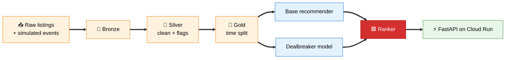

<div align="center">

# 🏠 Skip Signal

**A machine learning recommender system for property search that learns what buyers *don't* want, from the homes they keep skipping.**


### [🚀 Live demo](https://skip-signal-272542756101.australia-southeast2.run.app)

</div>

> [!TIP]
> Everyone builds recommenders around what buyers want. Skip Signal also uses what they **don't** want. A buyer who skips 57 homes far from the city is telling you something. Most systems throw that signal away.

---

## 🎯 Why, what, who

| | |
|---|---|
| **❓ Why** | Recommenders learn from clicks and saves but ignore skips. Buyers keep seeing homes that break their dealbreakers, waste time, and send fewer good enquiries to agents. |
| **💡 What** | A dealbreaker layer on top of any recommender. It learns each buyer's dealbreakers from their skips, then **removes** hard ones, **pushes down** soft ones, and explains every removal. |
| **👥 Who** | Built for home buyers, the agents who pay for leads, and the product team behind property discovery. Built by **Dolly Sahu**. |

## 🆚 How it's different from a normal recommender

Skip Signal is a **recommender system**: give it a buyer, it returns the 10 homes they are most likely to want. The difference is what it learns from.

| | Normal recommender | 🟥 Skip Signal |
|---|---|---|
| **Learns from** | Clicks, saves, enquiries | The same, **plus skips** |
| **Skips are** | Ignored as noise | A signal of what the buyer will never buy |
| **Unwanted homes** | Keep showing up | Removed or pushed down |
| **Explains itself** | No | Every removed home has a reason |
| **Risk control** | None | Tuned so it rarely hides a home the buyer wants |
| **Works with** | Itself | Plugs on top of **any** recommender (tested on two) |

> [!NOTE]
> **Property data is real** (13,580 Melbourne listings). **Buyer behaviour is simulated**, because real behaviour is private. The numbers prove the method, not real world lift.

---

## 📊 Results

Held out test days 46 to 60, 1,543 buyers.

| Model | Precision@10 | NDCG@10 | Wasted views ⬇️ | Wrongly hidden ⬇️ |
|---|:---:|:---:|:---:|:---:|
| Random | 0.240 | 0.314 | 32.4% | n/a |
| Content based (best baseline) | 0.256 | 0.339 | 28.3% | n/a |
| Two tower (PyTorch) | 0.244 | 0.327 | 31.6% | n/a |
| 🟥 **Skip Signal** | **0.266** | **0.350** | **25.9%** | **6.9%** |
| Oracle (perfect knowledge) | 0.277 | 0.360 | 23.3% | 6.4% |

- 🟢 **8.5% fewer wasted views** with **better** precision and NDCG
- 🟢 Wrongly hidden is **0.5 points from perfect**
- 🟢 Simulated A/B test: **enquiry rate up 14%** (6.8% to 7.8%)
- 🟢 All gains statistically real (bootstrap, 95% intervals clear of zero)
- ⚡ API answers in **5 to 25 ms**

---

## 🧭 How to use it

### Option 1: the website (no code)

Open the [live site](https://skip-signal-272542756101.australia-southeast2.run.app). The first load can take 10 seconds.

| Screen | What you do | What you see |
|---|---|---|
| **1. Start** | Pick a budget, click **Show us your no list** | 14 in 100 buyers know what they want. 86 in 100 figure it out as they go. |
| **2. Yes or no** | Say **No** or **Yes** to 12 real homes (or use the ← → keys) | A Street View photo, a room layout and the home's details. A live box shows what the model is noticing. |
| **3. Your homes** | Flip the **With and Without Skip Signal** toggle | What it learned, how many homes it hid, and your top homes with and without the model |

**Tip:** pick one thing you dislike, for example units, and say no to every one. After about 10 homes it spots the pattern.

The model is the same logistic regression used offline. It is fitted on your own clicks, live, each time you answer. No login and no personal data. Your clicks stay in your browser.

### Option 2: the API

**Live learning:** send the homes a visitor said yes or no to.

```
POST /learn
{
  "budget": 750000,
  "actions": [{"listing_id": 1234, "action": "skip"}, {"listing_id": 5678, "action": "save"}],
  "k": 6
}
```

**Output:** what it learned, how many homes it hid, and the next homes with and without the model.

```json
{
  "learned": [{"label": "Far from CBD", "level": "hard", "skipped": 4, "seen": 4}],
  "in_budget": 363,
  "hidden": 83,
  "homes": [{"address": "13 Merrill St", "suburb": "Mulgrave", "price": 757000, "rooms": 3}],
  "normal_homes": [{"address": "10 Plover Cl", "suburb": "Frankston", "price": 634000, "rooms": 3}],
  "latency_ms": 12.4
}
```

Other endpoints: `GET /budgets` (budget options) · `GET /health` (model version and counts) · `GET /recommend/{buyer_id}` (a simulated test buyer).

---

## 🏗️ How it works



**The ranker:** base model ranks homes ➜ remove hard dealbreakers ➜ push soft ones down ➜ keep 1 explore slot in case needs change.

---

## 🧪 Feature engineering

| Type | Features |
|---|---|
| 🏠 **Listing** | Price, rooms, bathrooms, car spaces, land size, distance to CBD, age, type, 6 dealbreaker flags |
| 👤 **Buyer** | Budget, usual rooms and type, overall skip rate, sessions |
| 🔗 **Buyer + home** | Price gap, room gap, number of suspected dealbreakers hit |
| ⭐ **Skip lift** | Skip rate on a category ÷ skip rate on everything else |

**What makes skip lift robust:**
- **Smoothing:** a Beta prior, so 2 skips out of 2 can't create a dealbreaker
- **Recency:** 14 day half life, so old skips fade
- **Right denominator:** compare with homes *outside* the category, not the overall rate

> [!IMPORTANT]
> **Leakage rules:** time based split (train days 1 to 45, test 46 to 60), features use past events only, and the hidden dealbreaker answers are never used as features.

**Dealbreaker categories** (in `config/dealbreakers.yaml`, no code change to add more): no car space, unit, one bathroom, small land, older build, far from CBD.

---

## 🤖 Models

Rule: **start simple, earn every step up with a number.**

| Task | Winner | Why |
|---|---|---|
| Recommend homes | Content based | Beat popularity, collaborative filtering and two tower |
| Find dealbreakers | **Logistic regression per buyer** | 98.3% vs 86.9% precision over skip lift, because it handles overlapping categories |
| Next action | Gradient boosting | Best macro F1 (0.249 vs 0.114 for "always guess view") |

Dealbreaker settings: C = 2, soft at score 2.5, hard at 4.0 and 3+ sessions. **Hard precision 98.6%.** Tuned for precision, because hiding a wanted home is worse than showing a skip.

---

## 🧠 Machine learning concepts used, and where

| Concept | Where in this project | File |
|---|---|---|
| **Machine learning** | The whole pipeline: features, training, evaluation, serving | `src/` |
| **Recommender system** | Ranks the top 10 homes for each buyer | `src/rank.py` |
| **Personalisation** | One dealbreaker model **per buyer**, plus each buyer's own taste profile and budget | `src/models/dealbreaker.py`, `src/features.py` |
| **Content based** | Cosine similarity between a buyer's liked homes and each listing's features | `src/models/baselines.py` |
| **Collaborative filtering** | Matrix factorisation (TruncatedSVD) on the buyer by home interaction matrix | `src/models/baselines.py` |
| **Deep learning** | Two tower neural network in PyTorch with in-batch negatives | `src/models/two_tower.py` |
| **Classification** | Dealbreaker model (skip or not, per buyer) and next action model (skip, view, save, enquire, leave) | `dealbreaker.py`, `next_action.py` |
| **Regression** | Logistic regression for dealbreakers, ridge and gradient boosting regression for dwell time | `dealbreaker.py`, `dwell.py` |
| **Decision trees** | Depth 5 decision tree, random forest and gradient boosted trees compared for next action | `src/models/next_action.py` |
| **Prediction model** | Predicts what a buyer will do next and how long they will look at a home | `next_action.py`, `dwell.py` |
| **Model training** | Time based training on days 1 to 45, threshold and C sweeps, class weights for rare enquiries | `src/gold.py`, `dealbreaker.py` |
| **Evaluation** | Precision@10, recall@10, NDCG@10, wasted views, wrongly hidden, macro F1, MAE, oracle, ablation, bootstrap, A/B simulation | `src/evaluate.py`, `src/experiments.py` |
| **Batch** | Nightly job that rebuilds data layers, retrains models and writes serving files | `src/batch.py` |
| **Real time** | API scores a buyer on each request in 5 to 25 ms | `src/api.py`, `src/serve.py` |
| **Deployment** | Docker image pushed to Artifact Registry and deployed on GCP Cloud Run | `Dockerfile` |
| **Monitoring** | Drift check compares the last 7 days with training data using PSI and alerts above 0.2. `/health` shows model version and counts. Every run logs latency and wrongly hidden rate. | `src/drift.py`, `src/api.py` |
| **Scikit-learn** | Logistic regression, TruncatedSVD, ridge, decision tree, random forest, gradient boosting, scalers, pipelines | `src/models/` |
| **PyTorch** | Two tower model: embeddings, MLP towers, Adam optimiser, softmax loss | `src/models/two_tower.py` |

---

## 📏 Metrics

| Metric | Meaning |
|---|---|
| **Precision@10** | Share of top 10 the buyer saved or enquired on |
| **NDCG@10** | Liked homes near the top score more (enquire 2, save 1) |
| **Wasted views %** | Share of top 10 the buyer skipped. The business metric. |
| **Wrongly hidden %** | Removed homes the buyer actually liked. The error that matters most. |
| **Macro F1** | For next action, because accuracy hides rare enquiries |

Each model re-ranks only the homes the buyer was **actually shown**, so nobody gets credit for homes no one saw.

---

## 🔬 Testing

| Test | What it showed |
|---|---|
| 🎯 **Oracle** | Even perfect knowledge wrongly hides 6.4% (simulator noise). My 5% target was impossible, so I reset it. |
| 🔍 **Error analysis** | False dealbreakers clustered at scores 3 to 4. Raising hard threshold to 4 cut them from 13.1% to 4.4%. |
| 👥 **Segments** | Helps new buyers (27.2% vs 29.0% wasted) and regular buyers (24.4% vs 27.7%) |
| 📈 **Bootstrap** | NDCG +0.011, wasted views −2.5 points, both real |
| 🆎 **A/B simulation** | Wasted views down, enquiries up 14%, both real |
| ✂️ **Ablation** | Hard removal and regularisation carry the system. Enquiry boost did nothing, so I **dropped it**. |

### 📉 Drift check

Compares the homes shown in the last 7 days with the training window, using PSI (population stability index). Above 0.2 means the data has shifted and the model should be retrained.

| Run | Price PSI | Result |
|---|:---:|---|
| Real data | 0.002 | ✅ No drift |
| Fake 25% price rise | 0.217 | 🚨 Alert: retrain now |

```powershell
python -m src.drift             # real check
python -m src.drift --simulate  # proves the alarm fires
```

**Honest misses:** two tower and dwell time regression didn't beat simpler models on this data, so they stayed out of the final system.

---

## ⚖️ Responsible AI

- 🛡️ Dealbreakers learn from **property features only**, never suburb (avoids income proxies)
- 💬 Every removal shows a reason: *"Removed: far from CBD. You skipped 57 like this."*
- 🧭 Explore slot keeps variety, avoids filter bubbles
- ⏳ Soft before hard: hiding needs strong, repeated evidence

---

## ▶️ Run it

```powershell
python -m venv .venv
.venv\Scripts\Activate.ps1
pip install -r requirements.txt
pip install torch --index-url https://download.pytorch.org/whl/cpu
```

Put `melb_data.csv` (Kaggle, Melbourne Housing Snapshot) in `data/raw/`, then:

```powershell
python -m src.bronze
python -m src.silver
python -m src.simulate
python -m src.gold
python -m src.models.dealbreaker
python -m src.training_data
python -m src.models.next_action
python -m src.evaluate
python -m src.experiments
python -m src.batch
uvicorn src.api:app
```

Open http://127.0.0.1:8000/ or run in Docker:

```powershell
docker build -t skip-signal .
docker run -p 8080:8080 skip-signal
```

**Photos:** set a Google Street View Static API key as the `STREETVIEW_KEY` environment variable on Cloud Run. Restrict the key to your site and to that one API, and cap the daily quota. Without a key, cards show a drawing instead.

**API:** `GET /health` · `GET /buyers?demo=true` · `GET /recommend/{buyer_id}?mode=dealbreaker`

---

## 🗺️ Roadmap

- 🔁 Retrain automatically when the drift check fires
- 🔎 Discover new dealbreakers from listing text and photos
- 🙋 Ask buyers to confirm: *"Hide homes with no car space?"*
- ⚡ Streaming updates with Pub/Sub
- 🏷️ Agent insights: *"40 buyers skipped your listing for no car space"*

<div align="center">

**Built with 🟥 by Dolly Sahu**

</div>
